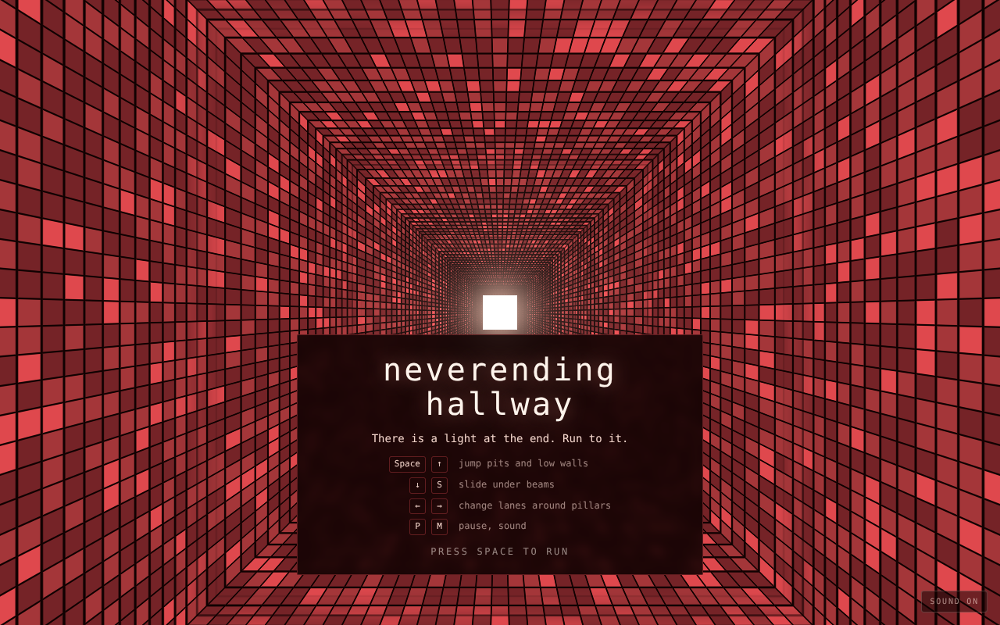
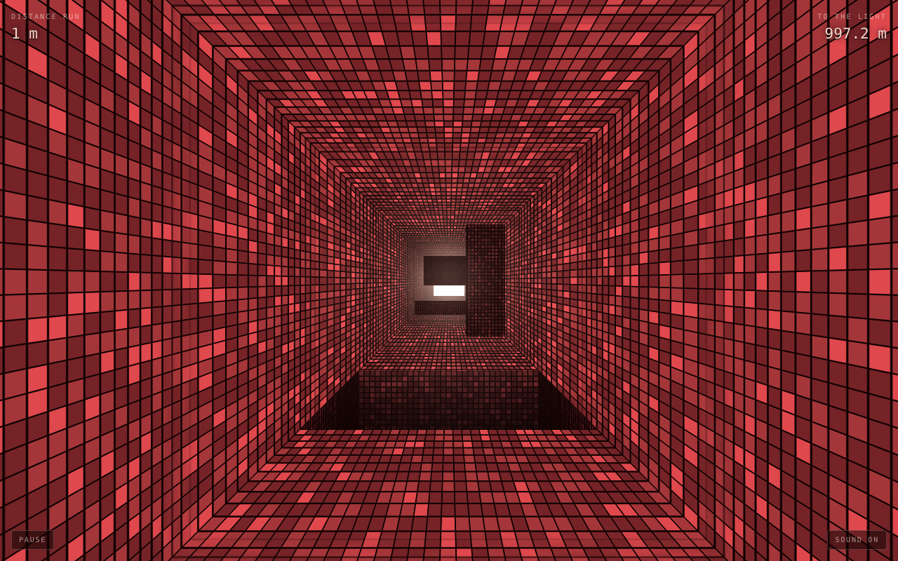
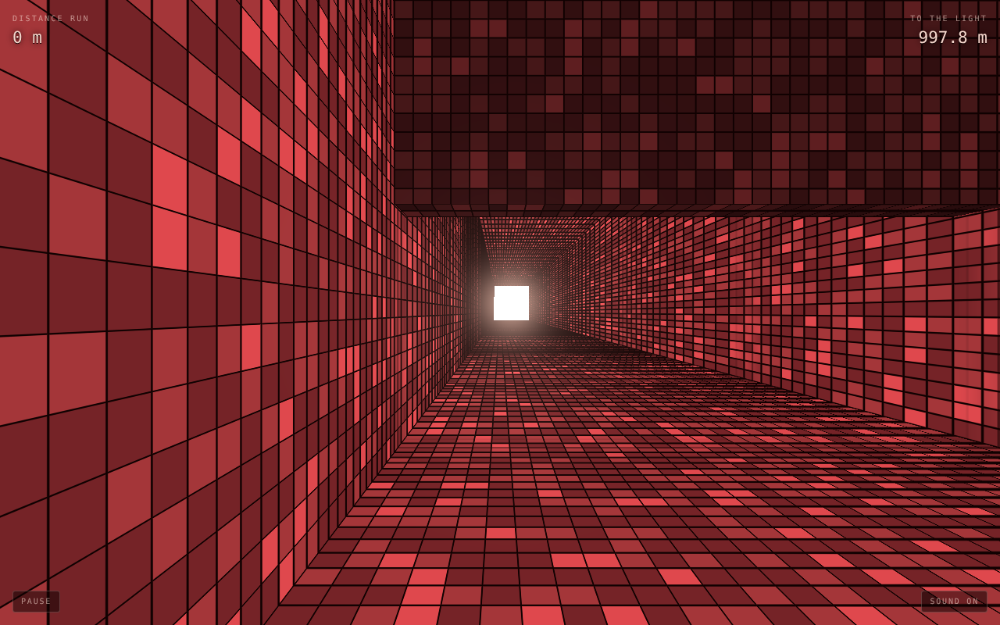
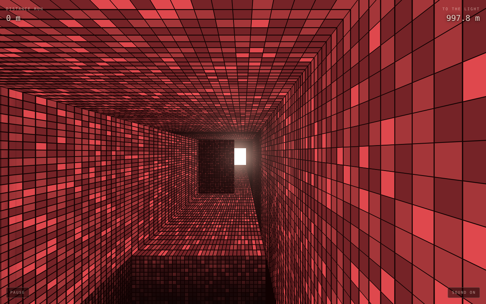

# Neverending Tunnel

A first-person runner through the Neverending Tunnel. Run for the light at the
end of the tunnel. You never reach it.

The tunnel is ray traced in a WebGPU fragment shader (`src/shaders/tunnel.wgsl`)
using the original asset's tile hash, colours, 33-column corner warp, 24-ring
repeat and 1.7px grout.



| | |
|---|---|
|  |  |
| Pit, pillar, low wall and beam | Sliding under a beam |
|  | |
| Jumping a pit | |

## Run

```sh
npm install
npm run dev      # http://localhost:5173
npm run build    # static build in dist/
```

Uses WebGPU where available (current Chrome, Edge or Safari) and falls back to
WebGL 2 with a GLSL port of the shader everywhere else.

## Controls

- Space / ↑ / swipe up: jump pits and low walls
- ↓ / S / swipe down: slide under beams
- ← → / A D / swipe sideways: change lanes around pillars
- P: pause, M: sound

## Layout

- `src/shaders/tunnel.wgsl`: tunnel, pits, obstacles and the light
- `src/shaders/tunnel.vert`, `tunnel.frag`: GLSL port for the WebGL 2 fallback
- `src/gpu.js`: WebGPU device, pipeline and uniform buffer
- `src/gl.js`: WebGL 2 fallback renderer
- `src/game.js`: running, jumping, sliding, spawning and collisions
- `src/main.js`: frame loop and uniform packing
- `src/input.js`, `src/hud.js`, `src/sound.js`: controls, HUD, audio
- `src/constants.js`: shared geometry and movement numbers

## NES version

`nes/` is a port to a real NES cartridge image (MMC3, 32 KB PRG, 232 KB CHR) with a four-channel
soundtrack. Play it in the browser at `/nes.html` (jsnes) or load `nes/tunnel.nes` in any emulator.

- The tunnel is a pixel raster of the original shader (`nes/tools/shader_port.py`): the 33-column
  corner warp, 24-ring repeat, lod blending, grout and the light's bloom. It is fitted to NES palettes
  and cut into tile bands that an MMC3 scanline IRQ swaps in, so every tile position has its own picture.
- Gameplay follows `src/game.js` in 8.8 fixed point: run-speed curve, jump and slide physics at 1/120 s
  steps, spawn rules, full-width pits, walls and beams, continuous collision, and the light distance that
  halves every 250 m. Obstacles are drawn into the nametable with the tunnel's tile style.
- Build with `nes/build.sh` (needs cc65 and python3 with numpy and Pillow). `nes/record_gif.sh` plays a
  round with a bot and writes a GIF.

- The camera follows the player like `camera()` in `src/game.js` (lane, jump and slide height, roll
  while changing lanes, head bob, pitch when falling into a pit). The tunnel picture is fixed, so the
  camera is a shear of it: an MMC3 scanline IRQ rewrites the scroll every 8 lines (sideways) and every
  32-line tile band (vertical), from a list the main loop rebuilds only when the camera moves.

Known differences: obstacles are tile footprints rather than ray-traced boxes (no side faces or pit
walls); the sideways camera shears the picture row by row, so off-centre the tunnel's rings bend
instead of shifting and the screen edge repeats the nearest wall column; vertical motion is scaled
down to a quarter.
