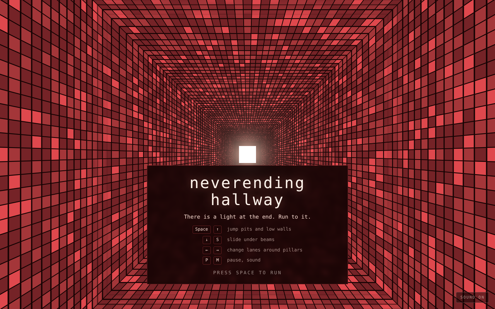
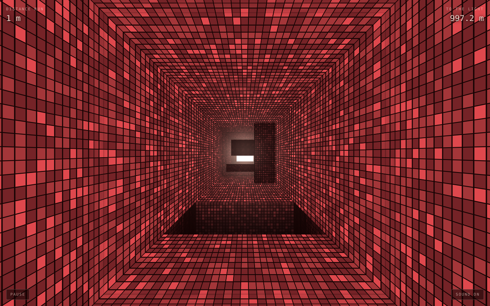
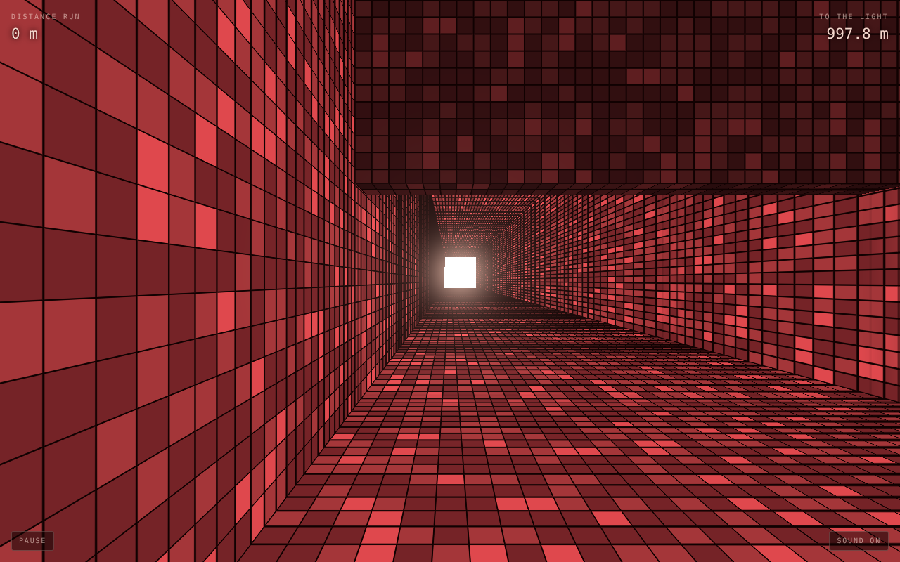
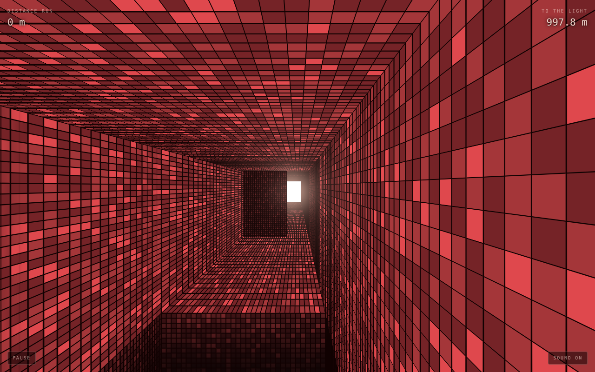

# Neverending Tunnel

A first-person runner through the Neverending Tunnel. Run for the light at the
end of the tunnel. You never reach it.

The tunnel is ray traced in a WebGPU fragment shader (`src/shaders/tunnel.wgsl`)
using the original asset's tile hash, colours, 33-column corner warp, 24-ring
repeat and 1.7px grout.



| | |
|---|---|
|  |  |
| Pit, pillar, low wall and beam | Sliding under a beam |
|  | |
| Jumping a pit | |

## Run

```sh
npm install
npm run dev      # http://localhost:5173
npm run build    # static build in dist/
```

Uses WebGPU where available (current Chrome, Edge or Safari) and falls back to
WebGL 2 with a GLSL port of the shader everywhere else.

## Controls

- Space / ↑ / swipe up: jump pits and low walls
- ↓ / S / swipe down: slide under beams
- ← → / A D / swipe sideways: change lanes around pillars
- P: pause, M: sound

## Layout

- `src/shaders/tunnel.wgsl`: tunnel, pits, obstacles and the light
- `src/shaders/tunnel.vert`, `tunnel.frag`: GLSL port for the WebGL 2 fallback
- `src/gpu.js`: WebGPU device, pipeline and uniform buffer
- `src/gl.js`: WebGL 2 fallback renderer
- `src/game.js`: running, jumping, sliding, spawning and collisions
- `src/main.js`: frame loop and uniform packing
- `src/input.js`, `src/hud.js`, `src/sound.js`: controls, HUD, audio
- `src/constants.js`: shared geometry and movement numbers
